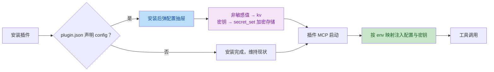

# 插件配置闭环设计

状态：设计稿（未实现）
范围：`kova-electron`（sidecar + desktop）与 `kova-plugins` 清单规范
关联：[mcp-secret-injection.md](./mcp-secret-injection.md)、[plugin-development.md](./plugin-development.md)

## 1. 问题

插件安装后缺少「在 Kova 里完成配置」的路径，用户只能去改外部文件或环境变量。以 GitLab 为例：

| 现状 | 证据 |
| --- | --- |
| 插件清单没有配置字段，codex 的 `interface/userConfig` 被整段忽略 | `apps/sidecar/pi-agent/src/plugins/manifest.ts` L315 |
| MCP 设置页把插件层条目当只读资产，只提供连接/授权/日志/启停 | `apps/desktop/components/settings/components/mcp-settings.tsx` L2259-L2261 |
| 插件层在合并顺序里最后生效，用户层无法覆盖 | `apps/sidecar/pi-agent/src/mcp/mcp-config.ts` L820-L831 |
| 插件必须自己读外部配置 | `kova-plugins/plugins/gitlab/mcp/lib/config.ts` L91-L149（`~/.kova/gitlab.json` + `GITLAB_URL`/`GITLAB_TOKEN`） |

后果：

- 安装完成后没有任何提示，用户不知道还缺 token；
- 密钥写在明文文件里，无法轮换、无法脱敏审计；
- 插件升级/卸载不会清理配置，残留值变成隐性状态；
- 市场里的插件卡片无法表达「已安装但未配置」。

## 2. 目标与非目标

目标：

- G1 安装后若缺必填配置，Kova 主动引导，而不是静默失败。
- G2 配置、密钥都在 Kova 内完成，且可在插件详情页随时修改、测试连接。
- G3 密钥只进加密存储，不出宿主、不进日志（复用现有密钥注入链路）。
- G4 对没有配置需求的插件零影响；插件升级不丢配置。

非目标（v1 明确不做）：

- 不允许插件自带任意配置 UI（不做 webview/panel 表单协议）；
- 不覆盖 HTTP MCP 的 `headers` 配置（仍走 OAuth；后续单列）；
- 不改变现有 OAuth 授权流程；
- 不允许工作区文件或插件清单声明密钥值（只允许声明「需要哪个密钥」）。

## 3. 方案总览

分两阶段，P0 解决「能覆盖」，P1 解决「有入口、可引导」。



### P0：插件 MCP 可覆盖（先止血）

不新增清单格式，只让用户在 Kova 内覆盖插件提供的 MCP 条目：

1. 合并顺序改为「插件层作为 base，系统层/工作区层依次覆盖」，同时保留字段级合并（`mergeEntry`）。插件目录始终保持只读。
2. MCP 设置页的插件行增加「覆盖」操作：可编辑 `command` / `args` / `env` / `url`，保存到用户层 `~/.kova/mcp.json`（同名条目）。
3. 行上展示「已覆盖」「恢复默认」；恢复时删除用户层条目。
4. 密钥继续走现有「密钥注入」：绑定记录带 configHash，覆盖后哈希变化 → 绑定自动失效并提示重新绑定（`mcp-secrets.ts` 现有行为，不改）。
5. 插件升级不受影响：用户层覆盖独立于插件目录。

P0 完成后，GitLab 用户可填 `GITLAB_URL`、绑定 `GITLAB_TOKEN`，不必改文件。

### P1：清单声明式配置（完整闭环）

`plugin.json` 增加 `config` 字段，宿主据此渲染表单、存储、注入。

```json
"config": [
  {
    "key": "url",
    "label": "GitLab 地址",
    "type": "url",
    "env": "GITLAB_URL",
    "default": "https://gitlab.com",
    "placeholder": "https://gitlab.example.com"
  },
  {
    "key": "token",
    "label": "Access Token",
    "type": "password",
    "env": "GITLAB_TOKEN",
    "required": true,
    "description": "需要 api 作用域；只写入 Kova 加密密钥库"
  }
]
```

字段约束：

| 字段 | 约束 |
| --- | --- |
| `key` | `^[a-z][a-z0-9_]{0,31}$`，单插件最多 16 个字段，key 不重复 |
| `label` | 1–40 字符 |
| `type` | `text` / `url` / `password` |
| `env` | `^[A-Z_][A-Z0-9_]*$`；仅对 stdio MCP 生效 |
| `required` | 布尔；缺失时该插件服务器保持未连接 |
| `default` | 字符串；仅非密钥字段允许 |
| `secret` | `type=password` 时恒为真，禁止显式设为 false |

### 运行时行为

1. 安装完成（`installPlugin` / `installLocalPlugin` 返回）后，renderer 读取已安装清单；若有 `config` 且必填项为空，打开配置抽屉。用户可跳过，插件标记「待配置」。
2. 保存时调用新协议 `plugin_config_set`：非敏感值入 kv，密钥值由 sidecar 转宿主 `secret_set` 加密落盘；不落配置、不回传明文。
3. 插件 MCP 服务器 spawn 前，sidecar 读取该 `pluginId` 的配置，按 `env` 映射合并进 `def.env`；密钥部分调用现有 `secret_env_resolve` 拿 env 映射（sidecar 只持有本次进程生命周期内的值，用于输出脱敏）。
4. 优先级（低 → 高）：`.mcp.json` 的 `env` 字面量 < P0 用户覆盖 `env` < P1 插件配置值 < 密钥注入绑定。
5. 必填缺失时：不启动该服务器，payload 中返回 `configState: "missing"`；界面显示「待配置」，点击直达抽屉。

## 4. 存储与数据模型

### 非敏感配置

kv key：`pi.plugin.config`，整包 JSON（失败不阻断启动，沿用 secrets 配置的容错策略）：

```json
{
  "version": 1,
  "plugins": {
    "gitlab": {
      "values": { "url": "https://gitlab.example.com" },
      "updatedAt": "2026-11-18T09:00:00.000Z"
    }
  }
}
```

### 密钥

- 使用现有加密密钥存储，scope 固定 `global`（原因见 [mcp-secret-injection.md](./mcp-secret-injection.md)：MCP 子进程跨工作区共享）。
- 生成名称：`PLUGIN_<PLUGIN_ID 大写、非字母数字转下划线>_<KEY 大写>`，例如 `PLUGIN_GITLAB_TOKEN`；长度上限 128，超限则报配置错误。
- 与用户手工创建的密钥同名时：保存前提示「将覆盖同名密钥」，不静默吞并。
- renderer 永不读取密钥值；配置抽屉的 password 字段编辑时留空 = 不修改，另设「清除」操作。

### 归属关系

`McpServerDef` 已带 `pluginId`（`mcp-config.ts` L76-L81），注入时按 `def.pluginId` 查配置即可，不需要额外的服务器→插件映射表。

## 5. 协议与接口改动

| 层 | 改动 |
| --- | --- |
| 协议 | 新增 `plugin_config_get` / `plugin_config_set` / `plugin_config_clear`；`mcp_servers` payload 的插件条目补 `configState`、`configFields` |
| sidecar | `plugins/manifest.ts` 解析 + 校验 `config`；新模块 `plugins/plugin-config.ts` 负责读写 kv；`mcp/mcp-config.ts` 注入 env；`mcp/mcp-secrets.ts` 增加 `resolvePluginConfigSecrets`；`plugins/marketplaces.ts` 卸载时清理 |
| 宿主 | 复用 `secret_set` / `secret_env_resolve`；无需新表 |
| renderer | 新增 `components/plugins/plugin-config-dialog.tsx`；`installed-plugins.tsx` 加状态徽标与入口；`mcp-settings.tsx` 插件行加「覆盖 / 配置」；`plugin-preview-dialog.tsx` 展示「安装后需要配置」 |
| 清单校验 | `kova-plugins/scripts/check.mjs` 增加 `config` 结构校验（key/env 唯一、type 白名单、secret 与 default 互斥） |

## 6. 失败与边界

| 场景 | 行为 |
| --- | --- |
| 必填缺失 | 服务器不启动，标记 `missing`，不阻塞其他 MCP |
| URL 非法 | 保存时拒绝（仅 `http/https`，去尾部斜杠） |
| 域名变更 | 视为配置变更：清除该服务器既有 secret 绑定，要求重新确认，避免 token 被发往新域 |
| 插件升级删除字段 | 保留 kv 值但标记 orphan，详情页提示可清理 |
| 插件升级新增必填 | 状态回到 `missing`，提示补填 |
| 卸载插件 | 删除 kv 配置与该插件生成的密钥；操作前二次确认 |
| 清单伪造 env | 只允许注入 `config[].env` 声明的变量名，未知变量忽略并记诊断 |

安全边界（继承现有原则）：

- 配置只从用户级 kv 与宿主密钥库读取；**工作区文件、插件目录、市场清单都不能提供值**；
- 密钥不写入 `.mcp.json`、不进日志、输出脱敏复用 `MCP_SECRET_VALUES`；
- 配置抽屉展示的值来自 kv，password 一律不回显。

## 7. 兼容与迁移

- 无 `config` 的插件：完全走现有路径，行为不变。
- GitLab 等已有插件：只需在 `plugin.json` 增加 `config` 并升 minor 版本；插件代码已支持 `GITLAB_URL` / `GITLAB_TOKEN` 环境变量，宿主注入后无需改插件逻辑。
- 老用户仍保留 `~/.kova/gitlab.json` 的：环境变量优先于文件（现有实现），配置抽屉保存后即接管；文档注明「两者可共存，Kova 配置优先」。
- P0 的合并顺序变更会影响「同名插件服务器 + 用户条目」的现有行为：当前仓库内无此组合，发布说明中单列一条。
- codex/claude 清单的 `userConfig`：继续忽略，不尝试兼容映射，避免引入第二套语义。

## 8. 实施拆分

P0（约 4 个文件）：

1. `mcp/mcp-config.ts`：调整合并顺序，插件层作为 base。
2. `mcp-settings.tsx`：插件行「覆盖 / 恢复默认」编辑器，写用户层。
3. `protocol/payloads.ts`：插件条目补 `overridden` 标记。
4. 回归测试：覆盖后用户层字段生效、恢复后回到插件值、configHash 失效提示。

P1（约 9 个文件 + 测试）：

1. `plugins/manifest.ts`：`config` 类型与规整（上限、去重、type 校验）。
2. `plugins/plugin-config.ts`：kv 读写、密钥命名、orphan 清理。
3. `mcp/mcp-config.ts`：spawn 前 env 注入。
4. `mcp/mcp-secrets.ts`：插件配置密钥解析。
5. `protocol/handlers/*`：三个新请求。
6. `protocol/payloads.ts`：`configState` / `configFields`。
7. `marketplaces.ts`：卸载清理。
8. `plugin-config-dialog.tsx`：表单、校验、测试连接。
9. `installed-plugins.tsx` / `mcp-settings.tsx` / `plugin-preview-dialog.tsx`：入口与状态。
10. `kova-plugins/scripts/check.mjs`：清单校验。

测试计划：

- 单元：manifest 规整、密钥命名边界、env 注入优先级、卸载清理。
- 集成：本地装一个带 `config` 的假插件，验证「未配置不启动 → 配置后连接 → 改 URL 触发重新确认」。
- 回归：无 config 插件安装、插件升级保留配置、secret 不出现在日志与 payload。

## 9. 备选方案

| 方案 | 不采用的原因 |
| --- | --- |
| 插件自带 `panel` 做配置页 | 每个插件重复造 UI，无法统一校验、密钥与脱敏 |
| 允许把 key 写进 `.mcp.json` | 密钥入库、无法轮换、市场分发即泄露 |
| 只靠环境变量 | 无发现性，桌面用户无法完成 |
| 复用 codex `userConfig` 语义 | 语义未覆盖 secret/注入/校验，且与现有密钥体系重复 |

## 10. 开放问题

1. 插件配置是否允许 `select` 类型（多环境、多实例）？v1 先不做。
2. 同名密钥覆盖是否要保留历史版本（轮换回滚）？当前密钥库无版本概念。
3. HTTP MCP 的 header 配置是否并入 P1 之后的下一个迭代？
